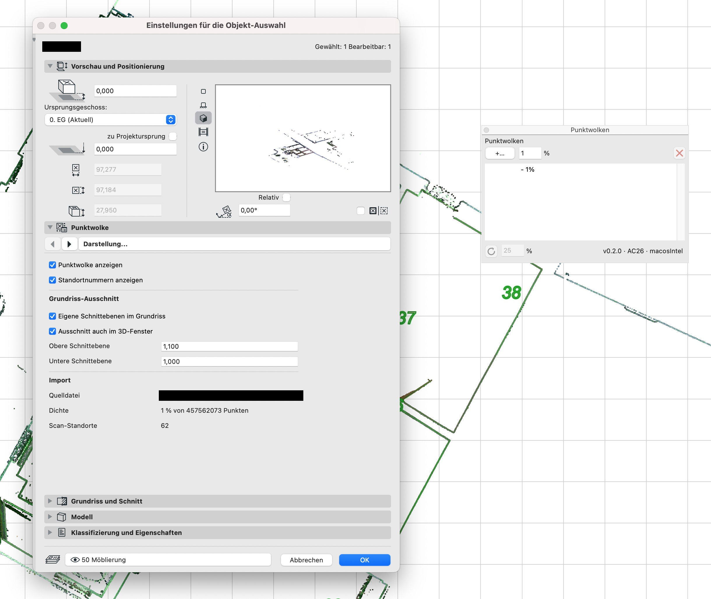

# Pointcloud4Archicad

Archicad-Add-on, das **E57-Punktwolken direkt in Archicad importiert** und als
platzierbares Bibliothekselement verwaltet — ohne Umweg über externe Konverter.

*Archicad add-on that imports E57 point clouds directly and manages them as
placeable library parts. The UI is German; the code and this README are the
documentation.*

## Was es tut

- **Import** einer `.e57`-Datei mit wählbarer Punktdichte (1–100 %). Pro
  Scan-Standort entsteht eine eigene `.gspc`-Datei (Archicads natives
  Punktwolkenformat), dazu ein GDL-Objekt (`.gsm`), das automatisch als
  Bibliothek eingebunden und im aktuellen Geschoss platziert wird.
- **Standorte ein-/ausblenden**: Im Objekt-Dialog lassen sich einzelne
  Scan-Standorte oder ganze Geschosse abschalten. Die Zuordnung Standort →
  Geschoss wird zur Laufzeit aus den Projektgeschossen berechnet und bleibt
  nach Geschossänderungen korrekt.
- **Standortnummern** als 3D-Text an den Scanner-Positionen.
- **Grundriss-Ausschnitt**: Die Wolke wird im Grundriss an der
  Geschoss-Schnittebene geschnitten; optional mit eigenen Höhen, optional auch
  im 3D-Fenster.
- **Dichte nachträglich ändern** (Reload in der Palette) — die E57 wird erneut
  gelesen, das Objekt behält seine GUID, platzierte Instanzen bleiben erhalten.
- **Löschen** entfernt platzierte Objekte, die erzeugten Dateien und den
  Bibliothekseintrag. Die E57-Quelldatei bleibt unangetastet.

Bedienung über eine dockbare Palette: **Planung → Punktwolken-Palette…**



## Dateien, die der Import erzeugt

```
Scans/Punktwolke.e57                    ← Quelle (bleibt unverändert)
Scans/Punktwolke/Punktwolke.gsm          ← GDL-Objekt
Scans/Punktwolke/Punktwolke_010_1.gspc   ← Standort 1 bei 10 % Dichte
Scans/Punktwolke/Punktwolke_010_2.gspc   ← Standort 2 …
Scans/Punktwolke/Punktwolke.guid         ← stabile Objekt-GUID
Scans/Punktwolke/Punktwolke.pwmeta       ← Import-Metadaten (Bounding-Box, Scanner-Positionen)
```

Der Ordner `Scans/Punktwolke/` wird als Bibliothek registriert. Der Projektpfad
zur E57 steht im Objekt (`sE57Path`) — daran erkennt die Palette ihre Objekte.

## Unterstützte Versionen

| Archicad | macOS (Intel) | Windows (x64) |
|---|---|---|
| 26, 27, 28, 29 | ✅ | ✅ |

Apple Silicon: das Add-on wird derzeit nur als x86_64 gebaut (Xerces-C aus
Homebrew ist Intel-only) und läuft unter Rosetta zusammen mit Archicad.

Die GDL-Objekte selbst sind versionsunabhängig.

## Installation (fertiges Add-on)

1. Bundle (`Pointcloud4Archicad_x86_64_XX.bundle`) bzw. `.apx` in einen
   Ordner deiner Wahl kopieren, z. B. `/Applications/GRAPHISOFT/Pointcloud4Archicad/`
2. Archicad → *Optionen → Add-On Manager → Hinzufügen* → Bundle wählen
3. Archicad neu starten

## Selbst bauen

### Voraussetzungen

- CMake ≥ 3.16, Python 3 (für Graphisofts `CompileResources.py`)
- **Archicad API Development Kit** der Zielversion(en) — kostenlos bei
  Graphisoft, nicht Teil dieses Repos. Erwarteter Pfad (siehe `CMakePresets.json`):
  ```
  ../../api/archicad/macos/API.Development.Kit.MAC.26.7000
  ../../api/archicad/windows/API.Development.Kit.WIN.26.7000
  ```
  Andere Ablage: `AC_API_DEVKIT_DIR` beim Konfigurieren übergeben.
- **libE57Format** wird per CMake `FetchContent` automatisch geladen.
- **Xerces-C** (Abhängigkeit von libE57Format):
  - macOS: `brew install xerces-c`
  - Windows: `vcpkg install xerces-c:x64-windows-static-md`
    (Pfad `XercesC_ROOT` in den Presets anpassen)
- macOS: Xcode; DevKit nach dem Download einmalig entquarantänen:
  `xattr -cr <DevKit-Ordner>`
- Windows: Visual Studio 2022 mit Toolset **v142** für AC26–28 und **v143** für AC29
  (die DevKit-Header erzwingen das).

### Build

```bash
cmake --preset ac26-mac-release          # konfigurieren
cmake --build --preset ac26-mac-release  # bauen
# → build/ac26/Release/Pointcloud4Archicad_x86_64_26.bundle
```

Presets gibt es für `ac{26,27,28,29}-{mac,win}-{debug,release}`.
Die Versionsnummer wird über `-DPW_VERSION=x.y.z` gesetzt (Cache-Variable).

Nach Änderungen an `RINT/*.grc.in` oder `RFIX.mac/Info.plist.in` erneut
konfigurieren — die Ressourcen werden beim Konfigurieren generiert.

## Wenn du das Projekt forkst

Das Add-on ist bei Graphisoft mit einer **MDID** registriert
(`RFIX/Pointcloud4ArchicadFix.grc`). Archicad identifiziert Add-ons darüber.
Ein Fork, der unter derselben MDID gebaut wird, kollidiert mit diesem Add-on,
sobald beide installiert sind. Bitte eine eigene MDID registrieren
(Graphisoft Developer Program, kostenlos) und dort eintragen.

## Aufbau

```
src/AddOnMain.cpp           Registrierung, Menü, Lebenszyklus
src/PunktwolkenPalette.*    dockbare DG::Palette
src/E57Importer.*           E57 → GSPC, GSM-Erzeugung (XML → LP_XMLConverter), Bibliotheksverwaltung
src/compat.h                API-Unterschiede AC26 ↔ AC27+ in einer Datei
RINT/, RFIX/, RFIX.mac/, RFIX.win/   Ressourcen (Dialog, Strings, MDID, Icons, plist)
```

Das GSM wird nicht über die API, sondern als XML geschrieben und mit Archicads
mitgeliefertem `LP_XMLConverter` kompiliert — `ACAPI_LibPart_Save` verweigert
das Schreiben in Ordner, die noch keine aktive Bibliothek sind.

## Lizenz

MIT — siehe [LICENSE](LICENSE). Abhängigkeiten: libE57Format (Boost Software
License), Xerces-C (Apache 2.0). Das Archicad-DevKit unterliegt Graphisofts
Lizenzbedingungen und wird nicht mitgeliefert.
